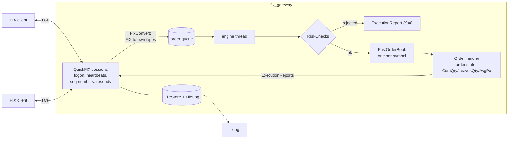

# fix-gateway

A FIX 4.4 order gateway in C++20. Clients connect over FIX, orders go through pre-trade risk
checks into my [limit order book](https://github.com/abhiroopyalavarthi/limit-order-book), and
every change in an order's state goes back to the client as an execution report. Sessions
survive a client crash: sequence numbers are persisted, and anything the client missed is resent
when it logs back on.

It's the third piece of a small trading system:

- [limit-order-book](https://github.com/abhiroopyalavarthi/limit-order-book): the matching engine
- **fix-gateway** (this repo): FIX connectivity, risk, execution reports, log analysis
- [algo-execution](https://github.com/abhiroopyalavarthi/algo-execution): TWAP/VWAP/POV algos in
  Python, which can trade through this gateway with a `FixExchange`

```
fix_gateway                      # acceptor on :9878
fix_client send --sender CLIENT1 --id ORD-1 --side buy --qty 300 --price 338.00
fixlog why ORD-1 log/gateway/FIX.4.4-GATEWAY-CLIENT1.messages.current.log
```

## Contents

- [How it's put together](#how-its-put-together)
- [A message flow](#a-message-flow)
- [Risk checks](#risk-checks)
- [Session recovery](#session-recovery)
- [fixlog](#fixlog)
- [Latency](#latency)
- [Trading the Python algos through it](#trading-the-python-algos-through-it)
- [Tests](#tests)
- [Building and running](#building-and-running)
- [What I'd do next](#what-id-do-next)

## How it's put together



```
include/ src/
  Types.h           the gateway's own request/report types (no FIX tags past the edge)
  Price.h           decimal string <-> integer ticks, rejects prices off the 0.01 grid
  FixConvert.*      QuickFIX messages <-> Types.h
  RiskChecks.*      max qty, max notional, price band, position limit, kill switch; config parser
  OrderHandler.*    order state + books; emits every execution report (tested without sockets)
  Gateway.*         QuickFIX Application: session callbacks -> queue -> engine thread
  main.cpp          fix_gateway, with an admin console on stdin (kill/unkill/dump/status)
client/             FixClient (initiator with its own order view + journal), fix_client CLI
tools/fixlog/       log analyzer (plain C++, no QuickFIX)
orderbook/          limit-order-book, git submodule
config/             gateway.cfg, client.cfg, risk.cfg, spec/FIX44.xml
scripts/            recovery_demo.sh, bench.sh
tests/              GoogleTest: unit tests + real-socket session tests
```

Design choices:

1. **FIX stays at the edge.** `FixConvert` turns a NewOrderSingle into a `NewOrder` struct as soon
   as it arrives, and an `ExecReport` into an ExecutionReport on the way out. `OrderHandler` and
   the book never see a tag number, so the book is the same engine I benchmarked on its own, and
   the order logic is tested with plain function calls.
2. **Integer ticks inside, decimals on the wire.** Tag 44 is parsed from its text, not through a
   double, so `338.25` is exactly 33825 ticks, and `338.255` is rejected instead of rounded.
   Prices go back out as exact strings too.
3. **One thread owns the books.** QuickFIX calls back on its session threads. Those callbacks only
   convert the message and push it onto a queue; a single engine thread pops it, runs risk and
   matching, and sends the reports. Matching is deterministic and there are no locks around the
   book.
4. **Every state change gets an execution report.** New, partial fill, fill, canceled (by the
   client, the kill switch, or an IOC/FOK/market remainder), replaced, rejected, and an
   order-status report when a client resends an order it isn't sure arrived. A cancel or replace
   that can't happen gets an OrderCancelReject instead. That's what makes the logs useful.
5. **Sequence numbers are persisted** with QuickFIX's FileStore, so a restart resumes the session
   instead of resetting it.

Cancel/replace follows exchange rules: a replace that only lowers the quantity keeps the order's
place in the queue (this needed a new `reduceOrder` in the order book, which shrinks an order in
place), while a price change or a quantity increase sends it to the back. A replace below the
quantity already filled is refused; one exactly at it completes the order.

## A message flow

Buy 300, get 100 filled, replace down to 250, get 50 more, cancel the rest, then try to cancel
again. This is `fixlog order` on the gateway's real session log:

```
CLIENT1 -> GATEWAY  seq 2   NewOrderSingle buy 300 AAPL @ 338.00
GATEWAY -> CLIENT1  seq 2   ExecutionReport New status=New cum=0 leaves=300
GATEWAY -> CLIENT1  seq 4   ExecutionReport Trade status=PartiallyFilled 100@338.00 cum=100 leaves=200  [PossDup]
CLIENT1 -> GATEWAY  seq 6   OrderCancelReplaceRequest buy 250 AAPL @ 338.00 (replaces FLOW-1)
GATEWAY -> CLIENT1  seq 6   ExecutionReport Replaced status=PartiallyFilled cum=100 leaves=150
GATEWAY -> CLIENT1  seq 8   ExecutionReport Trade status=PartiallyFilled 50@338.00 cum=150 leaves=100  [PossDup]
CLIENT1 -> GATEWAY  seq 10  OrderCancelRequest cancel FLOW-1b
GATEWAY -> CLIENT1  seq 10  ExecutionReport Canceled status=Canceled cum=150 leaves=0
CLIENT1 -> GATEWAY  seq 13  OrderCancelRequest cancel FLOW-1b
GATEWAY -> CLIENT1  seq 13  OrderCancelReject for FLOW-1b (cancel)  "too late to cancel: order is canceled"
```

The client in this example was a separate `fix_client` process per command, so it wasn't
connected when the fills happened. Both fills reached it later as resends (`[PossDup]`). The
first two messages on the wire:

```
8=FIX.4.4|9=131|35=D|34=2|49=CLIENT1|52=20260930-03:46:34.018229|56=GATEWAY|11=FLOW-1|38=300|40=2|44=338.00|54=1|55=AAPL|59=0|60=20260930-03:46:34|10=089|
8=FIX.4.4|9=180|35=8|34=2|49=GATEWAY|52=20260930-03:46:34.021047|56=CLIENT1|6=0.000000|11=FLOW-1|14=0|17=E1|37=O1|38=300|39=0|40=2|44=338.00|54=1|55=AAPL|60=20260930-03:46:34.020827|150=0|151=300|10=029|
```

CumQty (14) + LeavesQty (151) = OrderQty (38) in every report while the order is live; a test
checks it across a string of partial fills.

## Risk checks

`config/risk.cfg`, checked on every new order and every replace, before the book:

| Rule | Default | Reject text (tag 58) |
|---|---|---|
| Max order quantity | 50,000 | `order qty 60000 exceeds max 50000` |
| Max notional | $5,000,000 | `notional 6760000.00 exceeds max 5000000.00` |
| Price band | limit within 10% of the last trade | `price 380.00 outside 1000 bps band around last trade 338.00` |
| Position limit | 250,000 shares per symbol, counting fills *and* resting orders on that side | `position limit: long 250100 would exceed 250000` |
| Kill switch | admin command `kill CLIENT` | `kill switch active for CLIENT2` |

Limits can be overridden per client (the Python replay's liquidity provider needs much bigger
ones). A rejected order still gets an OrderID and a full ExecutionReport with OrdStatus=Rejected,
and never touches the book. The kill switch also cancels all of that client's open orders, each
with its own Canceled report, and leaves every other client alone.

Orders with values the gateway doesn't support (stop orders, other TimeInForce values, fractional
quantities, prices off the tick grid) get a Rejected execution report with the reason. Messages
that break FIX itself (a missing required tag, a bad checksum) are handled at the session layer by
QuickFIX and never reach the order handler.

## Session recovery

`scripts/recovery_demo.sh` is the end-to-end test: CLIENT1 streams buys, CLIENT2 streams sells at
the same price, and CLIENT1 gets `kill -9`'d partway through. While it's dead, CLIENT2 keeps
filling its resting orders. Then CLIENT1 restarts:

```
== CLIENT1 buys, CLIENT2 sells, 2000 orders each
== kill -9 CLIENT1 after 135 orders; CLIENT2 keeps filling its resting buys
== restarting CLIENT1
resuming after CLIENT1-135 (re-sent it with PossResend=Y)
reports 3923, resent by gateway 191, duplicates dropped 0, orders 2000

== does CLIENT1 agree with the gateway about every order?
yes: 2000 orders, identical status/cum/leaves/avgPx on both sides
gateway booked 2000 CLIENT1 orders, 2000 distinct ClOrdIDs (expected 2000): nothing lost or duplicated

== sequence numbers in the gateway's CLIENT1 log
GATEWAY -> CLIENT1 gap: expected 82, got 270 (188 missing)
CLIENT1 asked GATEWAY to resend 79..latest
GATEWAY -> CLIENT1: 192 messages resent with PossDupFlag=Y
OK: no unrecovered sequence gaps
```

How that works:

- Both sides use QuickFIX's FileStore. The gateway keeps storing (and numbering) reports for
  CLIENT1 while it's gone. When CLIENT1 logs back on, it sees the gateway's sequence number jump,
  sends a ResendRequest, and gets everything it missed with PossDupFlag=Y.
- The resend started at 79, not 82: the gateway had already written messages 79-81 to the socket
  when the client died, but the client never processed them. The client's sequence number only
  moves after it has handled a message, so those three came back too.
- The client journals each ClOrdID before sending it. On restart it doesn't know whether the last
  one got out, so it sends it again with PossResend=Y. The gateway recognizes the ClOrdID and
  answers with an order-status report instead of booking it twice.
- The client drops any report whose ExecID it has already applied, so a message that arrives both
  before the crash and in the resend isn't counted twice.

## fixlog

A CLI for the support questions in the job: why was this order rejected, why didn't it fill, did
the session lose anything. It reads QuickFIX's message logs (or any file with one FIX message per
line), follows ClOrdID -> OrigClOrdID chains through replaces and cancels, and answers in plain
English.

```
$ fixlog why FLOW-1 log/gateway/FIX.4.4-GATEWAY-CLIENT1.messages.current.log
FLOW-1: NewOrderSingle buy 300 AAPL @ 338.00, received 20260930-03:46:34.020438000 from CLIENT1.
Replace requested 20260930-03:46:38.168517000: OrderCancelReplaceRequest buy 250 AAPL @ 338.00 (replaces FLOW-1).
A cancel was refused 20260930-03:46:44.361659000: "too late to cancel: order is canceled".
CANCELED 20260930-03:46:42.300212000 with 150 filled, by the client's cancel request FLOW-1c sent 20260930-03:46:42.296864000.

$ fixlog why FLOW-2 log/gateway/*CLIENT1.messages.current.log log/gateway/*CLIENT2.messages.current.log
FLOW-2: NewOrderSingle buy 100 AAPL @ 337.00, received 20260930-03:46:46.430331000 from CLIENT1.
STILL WORKING (New): 0 filled, 100 resting at 337.00 as of 20260930-03:46:46.432316000.
No AAPL trades show up in this log after that, so nothing traded at or through its price.

$ fixlog rejects log/gateway/FIX.4.4-GATEWAY-CLIENT1.messages.current.log
20260930-03:46:44.361659000  GATEWAY -> CLIENT1  cancel FLOW-1d of FLOW-1b refused: "too late to cancel: order is canceled"
20260930-03:46:50.561700000  GATEWAY -> CLIENT1  order BIG-1 rejected: "notional 6760000.00 exceeds max 5000000.00"
20260930-03:46:52.620278000  GATEWAY -> CLIENT1  order ODD-1 rejected: "price '338.005' is not a positive price on the 0.01 tick grid"
```

`fixlog order ID` prints the full history (the flow above), `fixlog gaps` checks sequence numbers
per direction and tells a gap that was filled by a resend apart from one that never was, and
`fixlog summary` counts messages by type.

## Latency

`scripts/bench.sh` runs `fix_client bench`: pairs of orders (a buy that rests, then a sell that
fills it), so every order goes through the whole path: FIX parse and validation, the queue, risk,
the book, a trade, and execution reports back. Latency is order-to-ack, from the client calling
send to the client receiving the first ExecutionReport, measured one order at a time. Throughput
is with up to 64 orders in flight. 20,000 orders after 1,000 warm-up, Linux VM on an M2 MacBook Pro:

| Setup | p50 | p90 | p99 | p99.9 | Throughput |
|---|--:|--:|--:|--:|--:|
| FileStore + FileLog (the real setup) | 92 µs | 105 µs | 148 µs | 633 µs | 25,478 orders/s |
| MemoryStore, no log | 75 µs | 81 µs | 101 µs | 168 µs | 74,121 orders/s |

Almost none of the time is in the book, which does about 29.5M operations a second on its own. Per order it goes
to: parsing and validating the FIX message against the data dictionary, waking the engine thread
through a mutex and condition variable, building the execution report, and on each side writing
the message to the store and the log before it goes out. Persistence is what the second row takes
away: it barely moves the median but cuts throughput to a third, because every message is a file
write on both sides.

## Trading the Python algos through it

The [algo-execution](https://github.com/abhiroopyalavarthi/algo-execution) project has a
`FixExchange` with the same interface as its Python and C++ simulated exchanges. It opens two FIX
sessions: `ALGO` sends the strategy's child orders, and `LP` replays each minute bar into this
gateway's book (a sweep of resting orders, a ladder of liquidity around the bar's price, then
cancels), following the same fill model as the simulator. So a backtest run through the gateway
should give exactly the same fills as the simulator, and it does:

```
$ uv run algo fixcheck vwap --symbol AAPL --qty 200000 --date 2026-09-25
VWAP buy 200,000 AAPL 2026-09-25
  SimExchange:    390 fills, avg 338.3153, -16.26 bps vs VWAP
  FixExchange:    390 fills, avg 338.3153, -16.26 bps vs VWAP  (3.3 s through the gateway)
  identical fills, share for share
```

That's about 10,000 FIX messages per run (orders, liquidity, cancels and their reports). TWAP, POV
and the market maker also match fill for fill, and the algo code is unchanged: only the exchange
object is different.

## Tests

`ctest --test-dir build` (57 tests, run in CI on Ubuntu and macOS, plus the recovery demo):

- CumQty + LeavesQty = OrderQty in every report across partial fills; AvgPx after fills at three prices
- duplicate ClOrdID rejected (same id from a different client is fine); a PossResend of a known order isn't booked twice
- cancel of a filled order gets an OrderCancelReject, not an execution report; cancel of an unknown order too
- replace that changes price loses time priority; replace that lowers quantity keeps it; quantity up loses it
- replace below the filled quantity is rejected; replace down to exactly the filled quantity completes the order
- every risk rule accepts at its limit and rejects at limit + 1; position limit counts resting orders
- kill switch cancels all of one client's orders, leaves other clients alone, blocks new orders until reset
- IOC and market remainders are canceled with a report; FOK that can't fill never trades
- prices: exact parsing, off-grid rejects, formatting
- over real sockets: logon, heartbeats and clean logout; two clients crossing; risk reject; kill switch
- **recovery**: a client drops, misses 25 fills, reconnects; it receives them as resends and its view of all 40 orders matches the gateway's, with nothing booked twice
- a message missing a required tag gets a session-level reject, garbage on the socket doesn't crash anything, and the gateway keeps trading
- fixlog: history across replace/cancel, explanations, gap detection (filled vs. unfilled gaps), reject listing

## Building and running

Needs CMake 3.20+ and a C++20 compiler (Xcode command-line tools on a Mac). QuickFIX and
GoogleTest are downloaded and built by CMake.

```bash
git clone --recursive https://github.com/abhiroopyalavarthi/fix-gateway.git
cd fix-gateway
cmake -S . -B build -DCMAKE_BUILD_TYPE=Release
cmake --build build -j 8          # the first build compiles QuickFIX, ~1-2 min
ctest --test-dir build

build/fix_gateway                 # listens on 9878; type 'kill CLIENT1', 'dump', 'status' on stdin
build/fix_client send --sender CLIENT1 --id ORD-1 --side buy --qty 100 --price 338.00
build/fix_client bench --sender BENCH --orders 50000
scripts/recovery_demo.sh build
scripts/bench.sh build 50000
```

Clients allowed to log on are listed in `config/gateway.cfg`; limits and symbols are in
`config/risk.cfg`.

## What I'd do next

- **Cut latency** where it goes (see above): replace the mutex/condition-variable queue with a
  lock-free SPSC ring per session and a spinning engine thread, and move persistence off the
  critical path (write-behind to the store, or memory-mapped files).
- **Scale out**: one engine thread per group of symbols, since books don't share state, with the
  session layer routing by symbol. Dynamic sessions (QuickFIX's acceptor templates) instead of a
  fixed client list.
- **Drop copy** and **OrderStatusRequest (35=H)** so clients can reconcile without resending.
- **Market data out**: publish the book over FIX market data messages.
- **Risk** that's closer to real: per-account buying power, a message-rate throttle, fat-finger
  checks against a reference price feed rather than the last trade.
